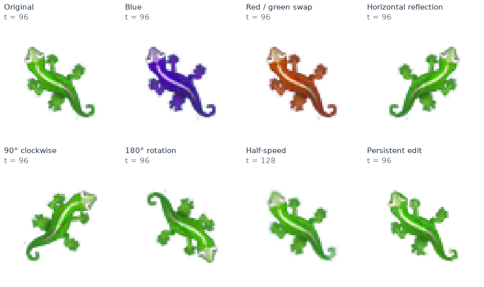

# Weight space reprogramming of neural cellular automata

**Stefano Nichele**  
Østfold University of Applied Sciences (Norway) · Simula AI Safety (Norway)  
[stefano.nichele@hiof.no](mailto:stefano.nichele@hiof.no)

[**Read the interactive report**](https://stenichele.github.io/NCA-weight-space-reprogramming/) · [**Read the PDF**](report.pdf) · [**Download code, weights and data**](https://raw.githubusercontent.com/stenichele/NCA-weight-space-reprogramming/main/downloads/reproducibility.zip) · [**Download the complete repository**](https://github.com/stenichele/NCA-weight-space-reprogramming/archive/refs/heads/main.zip)

Can a language model change what a neural cellular automaton grows by editing its weights directly? This research report studies seven edits of one published growing-gecko NCA using **GPT-6 Astra (`gpt-6-astra`)**, without gradient-based training.

NCAs are **local recurrent models**: the same small neural network updates every cell repeatedly. Changes to a local rule can propagate through space, accumulate through time, and alter behavior long after a recognizable organism has formed. We distinguish exact color/spatial symmetries from edits that change developmental dynamics.



## Experiments and main results

| Requested modification | Weight construction | Recorded result |
|---|---|---|
| Make the gecko blue | Swap green/blue input and output coordinates | 8/8 matched-randomness transformation tests |
| Exchange green and red | Swap red/green input and output coordinates | 8/8 matched-randomness transformation tests |
| Face the opposite direction | Reflect the x-gradient weights | 8/8 horizontal-reflection tests |
| Rotate 90° clockwise | Exchange and negate gradient blocks | 8/8 rotation tests |
| Rotate 180° | Negate both gradient blocks | 8/8 rotation tests |
| Grow more slowly | Halve output weights and biases | Maturity at step 112 versus 56 in all eight runs |
| Persist after growth | Add a bounded local timer and suppress developmental updates | 8/8 unseen trajectories pass through step 8,192 |

The five symmetry edits agree with the requested transforms to float32 numerical precision under appropriately coupled update masks. Independent stochastic runs also preserve the requested appearance. Persistence is achieved through **autonomous arrest**; regeneration, active homeostasis and indefinite stability were not demonstrated.

The six algebraic edits received no simulation feedback before submission. The persistence stage used **36 new adaptive evaluations**, each containing two 2,048-step rollouts: **72 rollouts and 147,456 individual grid forward passes** (73,728 calls with batch size two). It continued an existing Astra context with 12 prior evaluations available as background. The report presents the selected 36-evaluation result alongside the six edits.

The experiment date was 3 November 2026. The recorded model identifier is `gpt-6-astra`; an immutable model snapshot, temperature, top-p and generation seed were not recorded. See the report and [protocol details](REPRODUCIBILITY.txt) for numerical conventions, thresholds and limitations.

## Explore the results

- [Interactive experiments and animations](https://stenichele.github.io/NCA-weight-space-reprogramming/)
- [Ten-page scientific report](report.pdf)
- [Nine checkpoints: original, seven edits, and trained persistent control](weights/)
- [Simulator and exact edit constructions](code/)
- [Per-run metrics, search results and file hashes](data/)
- [Astra's six-edit explanation](records/six_edits_explanation.txt)
- [Astra's 36-evaluation experiment log](records/persistence_experiment_log.txt)
- [Astra's selected persistence mechanism](records/persistence_explanation.txt)

The research notes provide recorded hypotheses, observations, and submitted rationale. They are not a complete private internal chain-of-thought. Growth players use uniform four-step spacing; the long-horizon persistence player explicitly labels unequal checkpoint intervals.

## Reproduce the experiments

Use Python 3.13 and run the following from the repository root:

```bash
git clone https://github.com/stenichele/NCA-weight-space-reprogramming.git
cd NCA-weight-space-reprogramming
python3 -m venv .venv
source .venv/bin/activate
python -m pip install -r code/requirements.txt

# Fast check: reconstruct all seven edits and verify exact array equality.
python code/evaluate.py --experiment check --output reconstructed.json

# Independent simulation tests.
python code/evaluate.py --experiment symmetry --output reproduced_symmetry.json
python code/evaluate.py --experiment speed --output reproduced_speed.json
python code/evaluate.py --experiment persistence --output reproduced_persistence.json
```

On Windows, activate the environment with `.venv\Scripts\activate`. Use `--experiment all` to run all evaluations. The persistence audit simulates three checkpoints, eight trajectories each, through 8,192 steps and can take substantial time. These evaluation runs do not contact an LLM or require an API key. Different numerical libraries may produce small floating-point differences.

All checkpoints contain float32 arrays `W1` (48 × 128), `b1` (128), `W2` (128 × 16), and `b2` (16): **8,336 parameters**. The simulator uses a 65 × 65 grid, 16 channels, fixed Sobel perception, stochastic whole-cell updates with probability 0.5, and pre/post living masks. It does not emulate the original WebGL demo's quantized activation textures or periodic boundaries.

The selected persistence checkpoint can also be rebuilt directly:

```bash
python code/persistence.py weights/original.npz rebuilt_persistence.npz
```

Its SHA-256 is `04a6d67331bc97ae3102e4849e178e680ab8d86a20f33e6370f85a1163f33354`. The [manifest](data/manifest.json) records provenance and hashes. Full conventions and seeds are in [REPRODUCIBILITY.txt](REPRODUCIBILITY.txt).

## View the reports

Read the [interactive web report](https://stenichele.github.io/NCA-weight-space-reprogramming/) or download the [PDF](report.pdf). To view the web report offline, download the complete repository and open `index.html`; keep its figures and animations alongside it.

## Repository contents

| Path | Contents |
|---|---|
| `index.html`, `report.pdf` | Web and PDF reports |
| `code/` | Simulator, evaluator, exact weight edits and packaging |
| `weights/` | Original, seven edited checkpoints, trained persistent control |
| `records/` | Recorded Astra hypotheses, explanations and selected submission |
| `data/` | Archived measurements, provenance, hashes and animation metadata |
| `assets/`, `animations/` | Scientific figures, GIFs and synchronized player frames |
| `report_source/` | Shared manuscript and portable web/PDF renderer |
| `downloads/reproducibility.zip` | Compact research package |
| `REPRODUCIBILITY.txt` | Full protocol and runtime conventions |

## Attribution and license

The starting weights come from [Growing Neural Cellular Automata](https://distill.pub/2020/growing-ca/) by Alexander Mordvintsev, Ettore Randazzo, Eyvind Niklasson and Michael Levin (2020). Their checkpoint source is pinned in the manifest. The weight-space-programming motivation follows [Sparks of Weight-Space Programming](https://rikiyat.github.io/blog/weight-space-programming/).

This repository retains its [Apache 2.0 license](LICENSE). Upstream Distill material retains its [CC BY 4.0 license](code/SOURCE_LICENSE); see [NOTICE.md](NOTICE.md) for attribution and derivative checkpoint details.

## How to cite

Nichele, Stefano. (2026). *Weight space reprogramming of neural cellular automata*. Research report. Østfold University of Applied Sciences and Simula AI Safety, Norway. https://github.com/stenichele/NCA-weight-space-reprogramming

This is a repository-hosted research report; no journal, conference, arXiv identifier or DOI is asserted. When reproducing results, also record the Git commit used. GitHub's **Cite this repository** button uses [CITATION.cff](CITATION.cff).

```bibtex
@techreport{nichele2026weightspace,
  author      = {Nichele, Stefano},
  title       = {Weight Space Reprogramming of Neural Cellular Automata},
  institution = {{\O}stfold University of Applied Sciences and Simula AI Safety},
  address     = {Norway},
  year        = {2026},
  month       = nov,
  type        = {Research report},
  url         = {https://github.com/stenichele/NCA-weight-space-reprogramming},
  note        = {Code, weights, evaluation data, and interactive report available in the repository}
}
```
